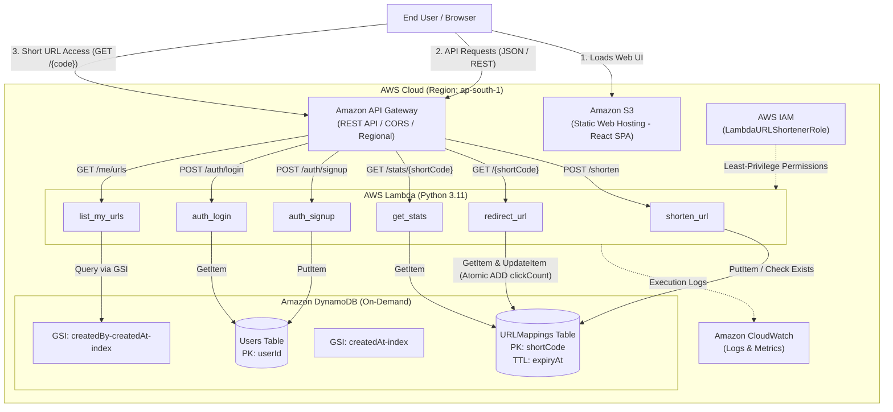

# SwiftLink — Serverless URL Shortener using AWS

A cloud-native, high-performance URL shortening and analytics platform built with a serverless architecture on Amazon Web Services (AWS). Designed to convert long URLs into compact aliases, execute sub-millisecond HTTP 301 redirects, track real-time click analytics, enforce automatic link expiration, and provide user authentication with personal link management.

---

## Table of Contents
- [Project Overview](#project-overview)
- [System Architecture](#system-architecture)
- [Key Features](#key-features)
- [Technologies & Tools Used](#technologies--tools-used)
- [Cloud Platform & AWS Services](#cloud-platform--aws-services)
- [Database Design](#database-design)
- [API Reference](#api-reference)
- [Application Workflow & Data Flow](#application-workflow--data-flow)
- [Repository Structure](#repository-structure)
- [Setup & Local Execution](#setup--local-execution)
- [Deployment Approach](#deployment-approach)
- [Testing & Validation](#testing--validation)
- [Team & Academic Context](#team--academic-context)

---

## Project Overview

Modern web applications require fast, reliable URL redirection with low operational overhead. SwiftLink implements an end-to-end serverless architecture that removes the need to provision, patch, or scale virtual machines.

### Why Serverless?
- **Zero Idle Cost**: Built entirely on pay-per-request infrastructure (AWS Lambda, DynamoDB On-Demand, API Gateway, S3).
- **Auto-Scaling**: Seamlessly scales from zero requests to thousands of concurrent redirections without manual intervention.
- **High Availability & Fault Tolerance**: Fully managed AWS regional services with built-in multi-AZ redundancy.
- **Low Latency**: DynamoDB single-digit millisecond key-value lookups paired with regional Lambda compute.

---

## System Architecture



---

## Key Features

1. **Fast URL Shortening**:
   - Generates 6-character alphanumeric Base62 short codes (`[a-zA-Z0-9]`), offering $62^6 \approx 56.8 \text{ billion}$ unique combinations.
   - Enforces URL validation (`http://` or `https://`).
2. **Custom Alias Support**:
   - Users can choose custom short aliases (3–20 characters: letters, numbers, `-`, `_`).
   - Built-in uniqueness verification returns `409 Conflict` on duplicates.
3. **Automatic Expiration & TTL**:
   - Configurable link expiration (`expirySeconds`).
   - Stored as an epoch timestamp in DynamoDB with native **Time To Live (TTL)** enabled for zero-cost background garbage collection.
   - Lambda implements a fallback expiration check returning `410 Gone` if TTL deletion hasn't completed yet.
4. **Atomic Click Tracking**:
   - Every redirect atomically increments `clickCount` using DynamoDB's `UpdateItem` with `ADD clickCount :inc` expression, avoiding race conditions under high concurrent traffic.
5. **Real-Time Click Analytics**:
   - Dedicated stats endpoint and UI displaying total clicks, creation date, target destination, and expiration status.
6. **Dynamic QR Code Generation**:
   - Client-side QR code generation (`qrcode.react`) for every generated short link.
7. **Stateless User Authentication**:
   - Secure signup and login with PBKDF2-HMAC-SHA256 password hashing (120,000 iterations + 16-byte random salt).
   - Stateless HS256 JWT tokens with Bearer authentication.
8. **Authenticated User Dashboard**:
   - Protected dashboard with tabbed navigation: Shorten URLs and view Link History.
   - History queried via DynamoDB Global Secondary Index (`createdBy-createdAt-index`) sorted newest first.
9. **Responsive UI & Dark Mode**:
   - Built with React 18, React Icons, and responsive CSS with persistent light/dark theme toggling.

---

## Technologies & Tools Used

| Domain | Technology / Tool | Version / Spec | Description |
|---|---|---|---|
| **Frontend** | React.js | 18.2.0 | Single-Page Application (SPA) initialized via CRA |
| | React Router DOM | 6.30.3 | Client-side routing and protected route handling |
| | Axios | 1.6.0 | Promise-based HTTP client with Bearer auth interceptors |
| | qrcode.react | 3.1.0 | SVG/Canvas QR code rendering component |
| | React Icons | 5.0.0 | Feather icon system for UI controls |
| **Backend** | Python | 3.11 | AWS Lambda execution runtime |
| | Boto3 SDK | 1.34+ | AWS SDK for Python interacting with DynamoDB |
| | Hashlib / HMAC / Base64 | Python stdlib | PBKDF2 password hashing and custom HS256 JWT implementation |
| **Cloud (AWS)** | Amazon S3 | Cloud Service | Static website hosting for compiled React assets |
| | Amazon API Gateway | REST API | Regional HTTP interface with Lambda Proxy Integration |
| | AWS Lambda | Serverless Compute | Microservices running Python backend functions |
| | Amazon DynamoDB | NoSQL Key-Value | Managed database with On-Demand billing, GSIs, and TTL |
| | Amazon CloudWatch | Observability | Centralized execution logging and error monitoring |
| | AWS IAM | Security & Auth | Least-privilege roles (`LambdaURLShortenerRole`) |
| **Testing & API** | Postman | v2.1.0 Collection | Automated test collection covering positive & negative test cases |
| | OpenAPI | 3.0.1 | REST API specification definition |

---

## Cloud Platform & AWS Services

### 1. Amazon API Gateway
- **Type**: Regional REST API (`URLShortenerAPI`).
- **Integration**: `AWS_PROXY` (Lambda Proxy Integration) passing raw HTTP headers, query parameters, and body directly to Lambda functions.
- **CORS**: Configured with `Access-Control-Allow-Origin: *`, `Access-Control-Allow-Headers: Content-Type,Authorization`, and `OPTIONS` preflight support on all resources.
- **Stage**: Deployed to `prod` stage.

### 2. AWS Lambda
- **Runtime**: Python 3.11.
- **Execution Model**: Event-driven execution invoked synchronously by API Gateway.
- **Environment Variables**:
  - `TABLE_NAME`: Target DynamoDB table name (`URLMappings`).
  - `USERS_TABLE`: DynamoDB table for user accounts (`Users`).
  - `BASE_URL`: Base URL prefix for generating short links (e.g., `https://[apiId].execute-api.ap-south-1.amazonaws.com/prod`).
  - `JWT_SECRET`: Secret key used for HMAC-SHA256 token signing and verification.
  - `HISTORY_GSI_NAME`: GSI index name (`createdBy-createdAt-index`).

### 3. Amazon DynamoDB
- **Billing Mode**: `PAY_PER_REQUEST` (On-Demand capacity) — zero fixed cost, autoscales instantly.
- **Primary Access Patterns**:
  - Fast $O(1)$ key lookup by `shortCode` for redirection.
  - Atomic counter increment on `clickCount`.
  - Secondary index querying by user ID for history.

### 4. Amazon S3
- Configured for **Static Website Hosting** (`index.html` as the index and error document) to host the production React application.

### 5. Amazon CloudWatch & AWS IAM
- Automated logging groups `/aws/lambda/<function-name>` capturing request metrics and runtime errors.
- IAM Role `LambdaURLShortenerRole` granting `AmazonDynamoDBFullAccess` and `CloudWatchLogsFullAccess`.

---

## Database Design

### Table 1: `URLMappings`

Stores short link records, redirection targets, TTL settings, and metrics.

- **Partition Key (PK)**: `shortCode` (String)
- **Sort Key (SK)**: *None* (Single key for $O(1)$ lookup performance)

| Attribute | DynamoDB Type | Role & Description |
|---|---|---|
| `shortCode` | `S` (String) | **Partition Key**: Unique 6-character random code or custom alias |
| `longURL` | `S` (String) | Destination URL to redirect to |
| `createdAt` | `S` (String) | ISO 8601 UTC timestamp of creation |
| `expiryAt` | `N` (Number) | Optional Unix epoch timestamp for DynamoDB TTL auto-delete |
| `clickCount` | `N` (Number) | Total redirection count, updated via atomic `ADD` |
| `customCode` | `BOOL` (Boolean) | `true` if custom alias was supplied by user, `false` otherwise |
| `createdBy` | `S` (String) | User ID of creator (if created by an authenticated user) |
| `ipAddress` | `S` (String) | Creator IP address (for rate limiting / auditing) |

#### Global Secondary Indexes (GSIs):
1. **`createdAt-index`**:
   - Partition Key: `createdAt` (String)
   - Projection: `ALL`
   - Purpose: Chronological scans and administrative reporting.
2. **`createdBy-createdAt-index`**:
   - Partition Key: `createdBy` (String)
   - Sort Key: `createdAt` (String)
   - Projection: `ALL`
   - Purpose: Fetching an authenticated user's link history sorted chronologically (`ScanIndexForward=False`).

#### TTL Configuration:
- Attribute: `expiryAt`
- Status: **Enabled**

---

### Table 2: `Users`

Stores registered user accounts and credentials.

- **Partition Key (PK)**: `userId` (String) — derived from SHA-256 hash of lowercase email (first 24 characters).

| Attribute | DynamoDB Type | Description |
|---|---|---|
| `userId` | `S` (String) | **Partition Key**: Deterministic 24-character user ID |
| `email` | `S` (String) | User email address (unique identifier) |
| `name` | `S` (String) | Display name |
| `passwordSalt` | `S` (String) | Cryptographic 16-byte random salt (Base64URL-encoded) |
| `passwordHash` | `S` (String) | PBKDF2-HMAC-SHA256 derived key (120,000 rounds) |
| `createdAt` | `S` (String) | ISO 8601 UTC registration timestamp |

---

## API Reference

Base Endpoint: `https://{apiId}.execute-api.ap-south-1.amazonaws.com/prod`

### 1. Shorten URL
- **Endpoint**: `POST /shorten`
- **Auth**: Optional (`Authorization: Bearer <token>`)
- **Request Body**:
  ```json
  {
    "longURL": "https://www.example.com/very/long/url/path",
    "customCode": "mycustomlink",
    "expirySeconds": 86400
  }
  ```
- **Responses**:
  - `200 OK`:
    ```json
    {
      "shortURL": "https://{apiId}.execute-api.ap-south-1.amazonaws.com/prod/mycustomlink",
      "shortCode": "mycustomlink",
      "createdAt": "2024-11-15T10:30:00.000000+00:00"
    }
    ```
  - `400 Bad Request`: Missing or invalid URL format.
  - `409 Conflict`: Short code already exists.

### 2. URL Redirection
- **Endpoint**: `GET /{shortCode}`
- **Auth**: None
- **Responses**:
  - `301 Moved Permanently`: Header `Location: <longURL>`
  - `404 Not Found`: Short code does not exist.
  - `410 Gone`: URL has expired.

### 3. URL Analytics
- **Endpoint**: `GET /stats/{shortCode}`
- **Auth**: None
- **Responses**:
  - `200 OK`:
    ```json
    {
      "shortCode": "abc123",
      "longURL": "https://www.example.com",
      "clickCount": 42,
      "createdAt": "2024-11-15T10:30:00.000000+00:00",
      "expiryAt": "1732012200"
    }
    ```
  - `404 Not Found`: Short code does not exist.

### 4. User Signup
- **Endpoint**: `POST /auth/signup`
- **Request Body**:
  ```json
  {
    "name": "Jane Doe",
    "email": "jane@example.com",
    "password": "Password123!"
  }
  ```
- **Responses**:
  - `200 OK`: Returns JWT token and user profile.
  - `400 Bad Request`: Validation failure (min password length: 8).
  - `409 Conflict`: User already registered.

### 5. User Login
- **Endpoint**: `POST /auth/login`
- **Request Body**:
  ```json
  {
    "email": "jane@example.com",
    "password": "Password123!"
  }
  ```
- **Responses**:
  - `200 OK`: Returns JWT token and user profile.
  - `401 Unauthorized`: Invalid credentials.

### 6. List User URLs
- **Endpoint**: `GET /me/urls`
- **Auth**: Required (`Authorization: Bearer <token>`)
- **Query Params**: `?limit=50` (optional, 1–200)
- **Responses**:
  - `200 OK`:
    ```json
    {
      "items": [
        {
          "shortCode": "abc123",
          "shortURL": "https://.../abc123",
          "longURL": "https://www.example.com",
          "createdAt": "2024-11-15T10:30:00+00:00",
          "clickCount": 12
        }
      ]
    }
    ```
  - `401 Unauthorized`: Missing or invalid Bearer token.

---

## Application Workflow & Data Flow

### 1. URL Shortening Workflow
1. User enters destination URL (optional: custom code, TTL) into React frontend.
2. Frontend validates input pattern (`http://` or `https://`, alphanumeric code) and sends `POST /shorten`.
3. If user is authenticated, the frontend attaches `Authorization: Bearer <token>`.
4. API Gateway invokes `shorten_url` Lambda function.
5. Lambda validates payload, checks for uniqueness in DynamoDB `URLMappings` table.
6. If unique, saves item with `createdAt`, optional `expiryAt` ($epoch = now + seconds$), and `clickCount = 0`.
7. Returns generated short URL; frontend renders Result Card and QR Code.

### 2. Redirection & Atomic Analytics Workflow
1. Client issues `GET /{shortCode}` to API Gateway.
2. API Gateway routes request to `redirect_url` Lambda.
3. Lambda performs `get_item` on `URLMappings`:
   - If not found $\rightarrow$ returns `404 Not Found`.
   - If `expiryAt` < current time $\rightarrow$ returns `410 Gone`.
4. If valid, Lambda issues an atomic DynamoDB `update_item` (`ADD clickCount :inc` where `:inc = 1`).
5. Lambda returns HTTP status `301 Moved Permanently` with `Location: <longURL>`.
6. Browser immediately redirects the user to the destination website.

---

## Repository Structure

```
serverless-url-shortener/
├── api-gateway/                      # API Gateway configuration and definitions
│   ├── api_definition.json           # OpenAPI 3.0 REST API specification
│   ├── postman_collection.json       # Postman test suite (TC01 - TC12)
│   └── README.md                     # Step-by-step API Gateway deployment guide
├── backend/                          # AWS Lambda microservice source code
│   ├── lambda/
│   │   ├── _shared/
│   │   │   └── auth.py               # Shared HS256 JWT signing and verification utility
│   │   ├── auth_login/
│   │   │   └── lambda_function.py    # Login handler (PBKDF2 validation + JWT issue)
│   │   ├── auth_signup/
│   │   │   └── lambda_function.py    # Registration handler (PBKDF2 salted hash + user record)
│   │   ├── get_stats/
│   │   │   ├── lambda_function.py    # Returns click analytics & metadata for a code
│   │   │   └── test_event.json       # Sample Lambda test event for stats lookup
│   │   ├── list_my_urls/
│   │   │   └── lambda_function.py    # Queries GSI for authenticated user's URLs
│   │   ├── redirect_url/
│   │   │   ├── lambda_function.py    # 301 HTTP redirection + atomic click counter
│   │   │   └── test_event.json       # Sample Lambda test event for redirection
│   │   └── shorten_url/
│   │       ├── lambda_function.py    # URL shortener logic & DynamoDB put
│   │       └── test_event.json       # Sample Lambda test event for shortening
│   └── README.md                     # Lambda configuration and IAM documentation
├── database/                         # DynamoDB schemas and index specifications
│   ├── gsi_config.json               # Global Secondary Index definitions and notes
│   ├── sample_items.json             # Sample test records for DynamoDB
│   ├── schema.json                   # Full table schema and attribute definitions
│   └── README.md                     # Step-by-step DynamoDB console creation guide
├── frontend/
│   └── url-shortener-frontend/       # React SPA source code
│       ├── public/                   # Static HTML templates, icons, and manifests
│       ├── src/
│       │   ├── auth/                 # AuthContext, RequireAuth route guard, localStorage token storage
│       │   ├── components/           # Reusable UI: Navbar, URLForm, ResultCard, StatsCard
│       │   ├── pages/                # Pages: HomePage, StatsPage, LoginPage, SignupPage, DashboardPage, NotFoundPage
│       │   ├── services/             # Axios API client and route methods (api.js)
│       │   ├── utils/                # Validation and timestamp formatting helpers
│       │   ├── App.jsx               # Application routing and theme provider
│       │   └── index.js              # Application entry point
│       ├── .env.example              # Environment variables template
│       ├── package.json              # React project dependencies and scripts
│       └── README.md                 # Frontend setup and local running guide
├── testing/                          # Test scripts and QA reports
├── .gitignore                        # Git ignore patterns
└── README.md                         # Main project documentation (this file)
```

---

## Setup & Local Execution

### Prerequisites
- **Node.js**: v18.x or later and `npm`
- **Python**: 3.11 (for local Lambda verification or unit tests)
- **AWS Account**: With permissions to create DynamoDB tables, Lambda functions, and API Gateway APIs.

### 1. Frontend Local Development
1. Navigate to the frontend directory:
   ```bash
   cd frontend/url-shortener-frontend
   ```
2. Install npm dependencies:
   ```bash
   npm install
   ```
3. Set up environment variables:
   ```bash
   cp .env.example .env
   ```
   Edit `.env` and set your API Gateway invoke URL:
   ```env
   REACT_APP_API_URL=https://{your-api-id}.execute-api.ap-south-1.amazonaws.com/prod
   ```
4. Start local development server:
   ```bash
   npm start
   ```
   The application will run at `http://localhost:3000`.

---

## Deployment Approach

The application is deployed using AWS managed services in the `ap-south-1` (Mumbai) region:

### Step 1: Create DynamoDB Tables
1. **Create Table `URLMappings`**:
   - Partition Key: `shortCode` (String)
   - Capacity: **On-Demand** (`PAY_PER_REQUEST`)
   - Enable TTL: Attribute name `expiryAt`
   - Create Global Secondary Indexes:
     - `createdAt-index` (PK: `createdAt` [String], Projection: `ALL`)
     - `createdBy-createdAt-index` (PK: `createdBy` [String], SK: `createdAt` [String], Projection: `ALL`)
2. **Create Table `Users`**:
   - Partition Key: `userId` (String)
   - Capacity: **On-Demand** (`PAY_PER_REQUEST`)

### Step 2: Configure IAM Execution Role
- Create role named `LambdaURLShortenerRole`.
- Attach policies:
  - `AmazonDynamoDBFullAccess` (or custom least-privilege policy for `URLMappings` and `Users`)
  - `CloudWatchLogsFullAccess` (for writing execution logs)

### Step 3: Deploy AWS Lambda Functions
Deploy the functions under `backend/lambda/` using Python 3.11 runtime:
- `shorten_url`
- `redirect_url`
- `get_stats`
- `auth_signup`
- `auth_login`
- `list_my_urls`

Set required environment variables in Lambda Console:
```
TABLE_NAME = URLMappings
USERS_TABLE = Users
BASE_URL = https://{your-api-gateway-url}/prod
JWT_SECRET = <your-secure-jwt-signing-key>
HISTORY_GSI_NAME = createdBy-createdAt-index
```

### Step 4: Configure & Deploy Amazon API Gateway
1. Create a **REST API** (`URLShortenerAPI`).
2. Create resources and methods:
   - `POST /shorten` $\rightarrow$ Lambda Proxy $\rightarrow$ `shorten_url`
   - `GET /{shortCode}` $\rightarrow$ Lambda Proxy $\rightarrow$ `redirect_url`
   - `GET /stats/{shortCode}` $\rightarrow$ Lambda Proxy $\rightarrow$ `get_stats`
   - `POST /auth/signup` $\rightarrow$ Lambda Proxy $\rightarrow$ `auth_signup`
   - `POST /auth/login` $\rightarrow$ Lambda Proxy $\rightarrow$ `auth_login`
   - `GET /me/urls` $\rightarrow$ Lambda Proxy $\rightarrow$ `list_my_urls`
3. Enable CORS on all endpoints (`Access-Control-Allow-Origin: *`).
4. Deploy the API to stage `prod` and copy the **Invoke URL**.

### Step 5: Build & Deploy React Frontend to Amazon S3
1. Compile production build:
   ```bash
   cd frontend/url-shortener-frontend
   npm run build
   ```
2. In AWS Console, create an S3 bucket (e.g., `swiftlink-frontend-hosting`).
3. Enable **Static Website Hosting** (`index.html` as index and error document).
4. Configure bucket policy for public read access (or route through CloudFront distribution).
5. Sync build assets:
   ```bash
   aws s3 sync build/ s3://swiftlink-frontend-hosting/
   ```

---

## Testing & Validation

The API is thoroughly validated using the included Postman collection (`api-gateway/postman_collection.json`):

| Test Case | Method | Endpoint / Condition | Expected Status | Validation Focus |
|---|---|---|---|---|
| **TC01** | `POST` | `/shorten` with valid HTTPS URL | `200 OK` | Verifies shortURL and shortCode generation |
| **TC02** | `POST` | `/shorten` with valid HTTP URL | `200 OK` | Verifies non-SSL HTTP URLs are accepted |
| **TC03** | `POST` | `/shorten` with invalid string | `400 Bad Request` | Verifies URL regex validation |
| **TC04** | `POST` | `/shorten` with empty body `{}` | `400 Bad Request` | Verifies required parameter validation |
| **TC05** | `POST` | `/shorten` with custom code | `200 OK` | Confirms custom alias allocation |
| **TC06** | `POST` | `/shorten` with duplicate custom code | `409 Conflict` | Confirms alias collision rejection |
| **TC07** | `GET` | `/{shortCode}` with valid code | `301 Redirect` | Verifies `Location` header redirect |
| **TC08** | `GET` | `/{shortCode}` with unknown code | `404 Not Found` | Verifies missing code handling |
| **TC09** | `POST` | `/shorten` with `expirySeconds: 60` | `200 OK` | Verifies TTL `expiryAt` computation |
| **TC10** | `GET` | `/{shortCode}` after expiry | `410 Gone` | Verifies link expiration enforcement |
| **TC11** | `GET` | `/stats/{shortCode}` with valid code | `200 OK` | Verifies accurate `clickCount` and metadata |
| **TC12** | `GET` | `/stats/{shortCode}` with invalid code | `404 Not Found` | Verifies stats error handling |

---

## Team & Academic Context

- **Institution**: Academic Year 2024–2025
- **Course**: VI Semester — Cloud Computing Micro Project

| Member | Role | Key Contributions |
|---|---|---|
| **Monika** | Frontend Developer | React SPA UI, dark/light theme, client-side routing, QR code integration |
| **RBM** | Backend / Cloud Engineer | Lambda microservices (Python 3.11), URL generation algorithms, auth logic |
| **PBC** | Database & API Manager | DynamoDB table design, GSI configuration, TTL policy, API Gateway REST configuration |
| **Parvati** | Testing, Docs & Deploy Lead | Postman test suites (TC01–TC12), QA validation, CloudWatch monitoring, deployment setup |
